<div align="center">
  
</div>

<br />

<div align="center">
  <a href="https://prideyang.top"></a>
  <a href="https://blog.prideyang.top"></a>
  <a href="https://doc.prideyang.top"></a>
</div>

<div align="center">
  
  
  
  
  
</div>

<br />

<div align="center">
  <samp>
    把代码、笔记与生活，一起安放在自己的域名下。<br />
    三个站点，一套子模块，一个入口 —— 这就是这个仓库存在的理由。
  </samp>
</div>

---

## 关于

全栈型选手，方向不单一：前端写界面，后端写服务，闲下来写笔记。

这个仓库本身不产出功能，它只是一个 **聚合入口** —— 把散落在三个独立仓库里的站点，用 `git submodule` 收拢到一处，让「我是谁、我写过什么、我在折腾什么」有一个统一的落点。

- 🏠 **主页** 是第一印象，讲究首屏与质感
- 📚 **文档** 是长期复利，讲究检索与沉淀
- 📝 **日常** 是慢变量，讲究写下就好

---

## 站点矩阵

| | 站点 | 一句话 | 技术栈 | 入口 |
| :--: | --- | --- | --- | --- |
| 🏠 | **home** | 载入动画、实时时钟、一言、常用站点导航 | `Vue 3 Vapor` `JSX` `Vite` `Tailwind 4` `Pinia` | [prideyang.top](https://prideyang.top) |
| 📝 | **blog** | 平淡生活里的微光，按年月归档的随笔 | `Hexo 8` `Butterfly 5` `Algolia` `KaTeX` | [blog.prideyang.top](https://blog.prideyang.top) |
| 📚 | **docs** | Java / dotnet / 数据库 / 中间件 的长线笔记 | `Vue 3` `TSX` `Vite` `UnoCSS` `Shiki` | [doc.prideyang.top](https://doc.prideyang.top) |

> **home** 由 `imsyy/home` fork 后以 Vapor 模式 + JSX 重写，目标是把首屏渲染压到极致。
> **blog** 开启文章资源目录，图片与文章同源管理；**docs** 在 Vite 之上自行实现了 Fumadocs 风格的容器语法与代码块增强。

---

## 技术栈

<div align="center">


</div>

---

## 仓库结构

```text
lytree/
├── home/                    # 个人主页 · Vue 3 Vapor + JSX
├── blog/                    # 日常随笔 · Hexo 8 + Butterfly 5
├── docs/                    # 个人文档 · Vue 3 + TSX 版 Fumadocs
├── profile/                 # README 资产：横幅与数据卡片
│   ├── banner.svg           #   手写渐变横幅
│   ├── stats.svg            #   总览卡片（Actions 每日刷新）
│   └── top-langs.svg        #   语言构成（Actions 每日刷新）
├── .github/workflows/
│   └── cards.yml            # 每天 03:00 UTC 重算数据卡片并提交
└── README.md
```

三个站点均为独立仓库，以子模块形式挂载。改动请进子目录提交，主仓库只负责更新指针。

---

## 本地起跑

```bash
# 一次拉全，含所有子模块
git clone --recurse-submodules https://github.com/lytree/lytree.git
cd lytree

# 已克隆但没带子模块时
git submodule update --init --recursive
```

三个站点各自独立构建，互不干扰：

```bash
pnpm --dir home install && pnpm --dir home dev      # 主页   → localhost:5173
pnpm --dir blog install && pnpm --dir blog server   # 随笔   → localhost:4000
pnpm --dir docs install && pnpm --dir docs dev      # 文档   → localhost:5173
```

<details>
<summary><b>更新子模块到最新</b></summary>

```bash
git submodule update --remote --merge
git add . && git commit -m "chore: 更新子模块指针"
```

</details>

---

## 数据

<div align="center">



<br />


</div>

<sub>卡片由 [`.github/workflows/cards.yml`](./.github/workflows/cards.yml) 每日 03:00 UTC 从 GitHub API 重新生成并提交，读到的是仓库内的静态快照，不依赖第三方服务实时渲染。</sub>

---

<div align="center">
  <samp>
    Built with Vue · Hexo · 和一点固执。
  </samp>
  <br /><br />
  <sub>© 2026 lytree · 站点内容采用 MIT 协议</sub>
</div>
