<a href="http://prideyang.top/">个人首页</a> | <a href="http://blog.prideyang.top/">日常</a> | <a href="http://doc.prideyang.top/">个人文档</a> 

 
 

  

## 项目

三个站点以 git submodule 的形式收在本仓库里，各自独立仓库、独立部署，详细说明见各项目自己的 README。

### 🏠 home · [prideyang.top](http://prideyang.top/) · [源码](https://github.com/lytree/home) · [README](https://github.com/lytree/home#readme)

基于 **Vue 3 Vapor 模式 + JSX** 重写的个人主页，追求极致的首屏渲染性能。包含载入动画、实时时间与日期、Hitokoto 一言、常用网站导航轮播、自定义光标、壁纸背景切换与移动端适配。

技术栈：Vue 3.6（Vapor）、Vite 6、TypeScript 5、vue-jsx-vapor、Pinia、VueUse、Tailwind CSS 4、Sass Modules、Swiper。

### 📚 docs · [doc.prideyang.top](http://doc.prideyang.top/) · [源码](https://github.com/lytree/docs) · [README](https://github.com/lytree/docs#readme)

个人文档站，把 **Fumadocs 的 Vue 3 + TSX 移植**过来，并接入 VitePress 的布局与写作体系。内容用纯 Markdown 撰写，内置 `::: tip` / `::: details` / `::: code-group` 等容器、代码行高亮与 diff 标注、文件导入、KaTeX 数学公式、Shiki 双主题和全文搜索。

之所以选 markdown-it 而非 MDX：`List<String>`、`a < b` 这类写法在 MDX 下会触发 JSX 解析错误，markdown-it 则天然安全。自研内容管线兼容 Fumadocs 的 `meta.json` 页面树，新增目录即可自动出现在侧边栏。

技术栈：Vue 3 + TSX、Vue Router、Vite 6、UnoCSS、SCSS Modules + lightningcss、markdown-it、Shiki、KaTeX；可选 Playwright 预渲染为静态 HTML。

### ✍️ blog · [blog.prideyang.top](http://blog.prideyang.top/) · [源码](https://github.com/lytree/blog) · [README](https://github.com/lytree/blog#readme)

日常随笔站点，基于 **Hexo 8 + Butterfly 5** 主题，按年份归档文章。支持文章加密、KaTeX 公式渲染、代码块复制/折叠，并预留 Algolia 全文搜索依赖；写作即提交，构建后发布静态页面。

技术栈：Hexo 8、hexo-theme-butterfly 5、hexo-algoliasearch、hexo-blog-encrypt、markdown-it（KaTeX 插件）、pnpm。
